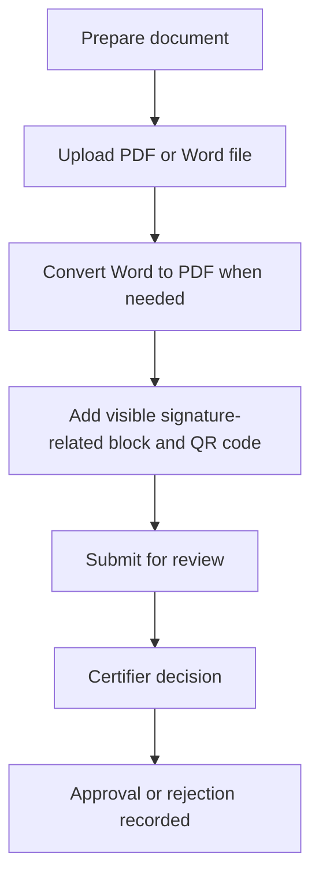

# e-Hastakshar — Document Approval Workflow

A Python/Flask prototype for preparing documents, converting Word documents to PDF, adding visible signature-related blocks and QR codes, and moving documents through an approval workflow.

> **Status: portfolio prototype — not production-ready.** Authentication, authorization, uploaded-file access, secret management, and document-integrity guarantees need security review before public deployment. Do not upload confidential or real defence/organizational documents.

## What is in this repository

- Flask application in `app.py`
- HTML templates for the home page and Prepared, Certifier, and Manager dashboards
- PDF processing using PyPDF2, pdfminer, PyMuPDF, and ReportLab
- QR-code image generation
- JSON files created by the app at runtime to store users, documents, and history

## Workflow at a glance

This diagram describes the intended workflow in the current application; it is not a claim of cryptographically verifiable digital signatures.

## Technology

- Python and Flask
- HTML templates
- PyPDF2, PyMuPDF, pdfminer, ReportLab
- qrcode and Pillow
- Windows COM automation for Word-to-PDF conversion

## Running locally

This project currently has no committed dependency lock or `requirements.txt`. It also uses Windows COM automation for DOC/DOCX conversion, which requires a compatible Windows environment with Microsoft Word installed. Dependency and setup instructions should be verified on a clean machine before publishing a runnable demo.

The app currently listens on port `5057` and enables Flask debug mode in its startup code. Do not expose it to the public internet as-is.

## Security work required before a live demo

- Replace the hardcoded Flask secret with an environment-provided secret.
- Hash passwords rather than storing them in plaintext.
- Enforce role and ownership checks on every document action.
- Require authorization before serving uploaded documents.
- Add upload size/type controls, CSRF protection, and safe error handling.
- Use a non-debug production server and isolated demo data.

## Screenshots and demo

Screenshots and a public demo are not included yet. Add genuine screenshots of the home page, each dashboard, document preparation, and the review result here after testing with synthetic documents and demo accounts.

## Author

Harish T · Python Backend Developer

Repository: https://github.com/Hari24022002/Digital-Signature
